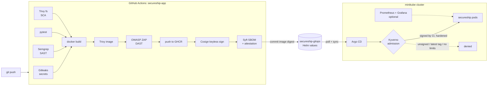

# SecureShip: secure software supply chain with GitOps

A small FastAPI service shipped through a pipeline where **every commit is scanned, every image is
signed, and the cluster refuses to run anything the pipeline did not sign.**

Deployment config lives in the companion repo
[secureship-gitops](https://github.com/ArpitSinghal-DevOps/secureship-gitops) (Helm chart, Argo CD apps, Kyverno policies, monitoring).

## Architecture



## Security controls

| Layer | Control | Tool |
|---|---|---|
| Source | Secret detection across full git history | Gitleaks |
| Source | SAST (Python + OWASP Top 10 rules, workflow hardening) | Semgrep |
| Dependencies | Vulnerable package detection | Trivy fs, Dependabot |
| Image | OS + library CVE scan, minimal non-root image | Trivy image, multi-stage Dockerfile |
| Runtime app | Dynamic scan of the running container | OWASP ZAP baseline |
| Supply chain | Keyless signing bound to this repo's workflow identity | Cosign + Sigstore (GitHub OIDC) |
| Supply chain | SBOM generated and attested to the image | Syft + Cosign attest |
| Supply chain | Actions pinned to commit SHAs, least-privilege tokens | GitHub Actions |
| Delivery | Deploy by immutable digest, drift auto-reverted | Argo CD (GitOps) |
| Admission | Only CI-signed images; digest pinning, limits, non-root, read-only FS | Kyverno |
| Network | Default-deny NetworkPolicy (HTTP in, DNS out) | Calico |
| Observability | Request rate, errors, p95 latency, restarts (optional, off on small laptops) | Prometheus, Grafana |

## Run locally

```bash
python3 -m venv .venv && . .venv/bin/activate
pip install -r requirements-dev.txt
python -m pytest -q
uvicorn app.main:app --port 8080
```

Endpoints: `/` (service info), `/health`, `/metrics` (Prometheus).

## Setup

See [SETUP.md](https://github.com/ArpitSinghal-DevOps/secureship-gitops/blob/main/SETUP.md) for the full step-by-step guide and demo script.
