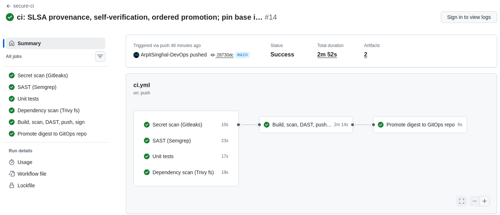
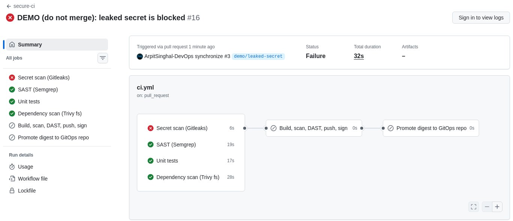
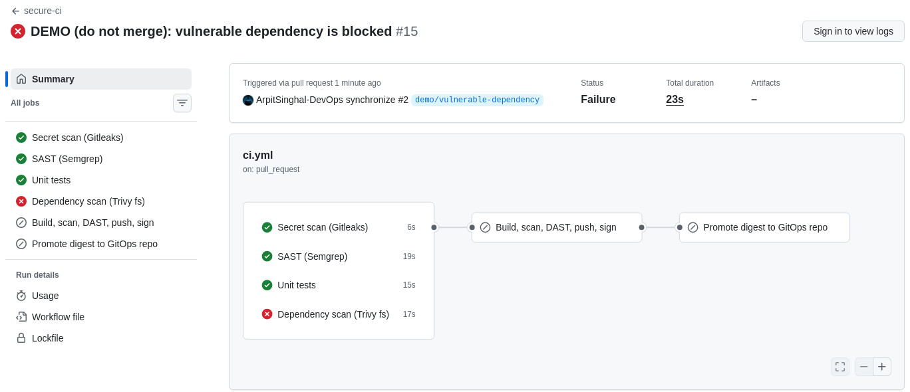
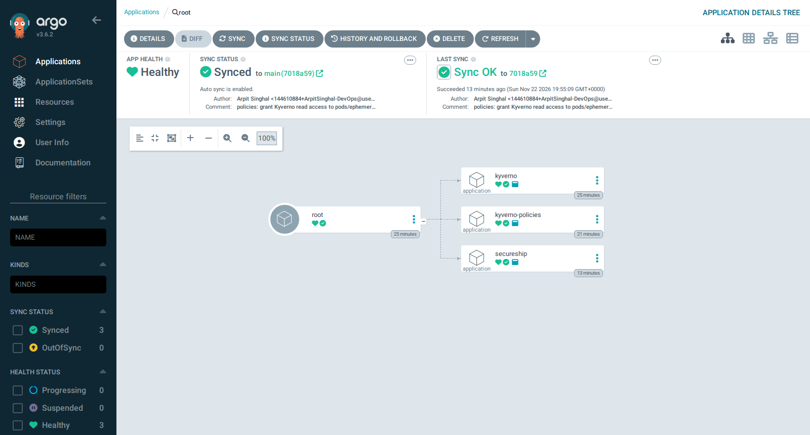
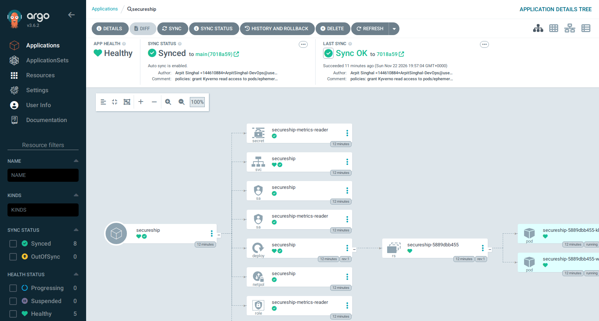
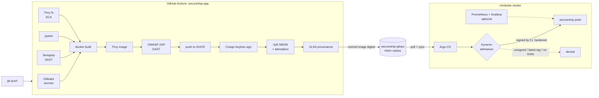

# SecureShip: secure software supply chain with GitOps

A small FastAPI service shipped through a pipeline where **every commit is scanned, every image is
signed, and the cluster refuses to run anything the pipeline did not sign.**

**Full architecture and step-by-step build guide: [docs/ARCHITECTURE.md](docs/ARCHITECTURE.md)** (diagrams, how each control works, what the security review found).

Deployment config lives in the companion repo
[secureship-gitops](https://github.com/ArpitSinghal-DevOps/secureship-gitops) (Helm chart, Argo CD apps, Kyverno policies, monitoring).

## See it work

**Every push to `main`**: scanned, built, DAST-tested, pushed, signed, SBOM and provenance
attested, verified, then promoted to the GitOps repo by digest.



**Bad changes stop at the gate.** Each demo PR fails only the check it should fail:

| Leaked credential: Gitleaks fails ([PR #3](https://github.com/ArpitSinghal-DevOps/secureship-app/pull/3)) | Vulnerable dependency: Trivy fs fails ([PR #2](https://github.com/ArpitSinghal-DevOps/secureship-app/pull/2)) |
|---|---|
|  |  |

**Argo CD owns the cluster** (app-of-apps: Kyverno, then policies, then the app):




**The cluster refuses anything the pipeline did not sign.** Real output from the minikube cluster:

```console
$ kubectl run evil -n secureship --image=nginx@sha256:6784fb08…   # digest-pinned, limits, non-root, read-only
Error from server: admission webhook "ivpol.validate.kyverno.svc-fail-finegrained-verify-secureship-signature"
denied the request: Policy verify-secureship-signature failed: image is not signed by the secureship-app CI
pipeline (main branch); ... attestor "github": failed to verify cosign signatures: no signatures found

$ kubectl run sneaky -n secureship --image=<signed secureship-app digest> \
    --overrides='{... "initContainers":[{"image":"nginx@sha256:6784fb08…", ...}] ...}'
Error from server: ... Policy verify-secureship-signature failed: image is not signed by the secureship-app CI
pipeline (main branch); verification details: image "nginx@sha256:6784fb08…" ...

$ kubectl debug -n secureship pod/secureship-5889dbb455-klhws --image=busybox
Error from server: admission webhook "vpol.validate.kyverno.svc-fail" denied the request:
Policy secureship-pod-hardening failed: ephemeral (debug) containers are not allowed in this namespace

$ kubectl run lazy -n secureship --image=nginx:1.27
Error from server: admission webhook "vpol.validate.kyverno.svc-fail" denied the request:
Policy secureship-pod-hardening failed: every container, including init containers, must set CPU and memory limits

$ kubectl -n secureship scale deploy secureship --replicas=5; sleep 25; kubectl -n secureship get deploy
NAME         READY   UP-TO-DATE   AVAILABLE   AGE
secureship   2/2     2            2           2m17s        # Argo CD self-heal reverted the drift
```

## Architecture



## Security controls

| Layer | Control | Tool |
|---|---|---|
| Source | Secret detection across full git history | Gitleaks |
| Source | SAST (Python + OWASP Top 10 rules, workflow hardening) | Semgrep |
| Dependencies | Vulnerable package detection | Trivy fs, Dependabot |
| Image | OS + library CVE scan, minimal non-root image, base image pinned by digest | Trivy image, multi-stage Dockerfile |
| Runtime app | Dynamic scan of the running container | OWASP ZAP baseline |
| Supply chain | Keyless signing bound to this repo's workflow identity | Cosign + Sigstore (GitHub OIDC) |
| Supply chain | SBOM generated and attested to the image | Syft + Cosign attest |
| Supply chain | SLSA build provenance attested and pushed to the registry; signature, SBOM and provenance re-verified in CI | GitHub artifact attestations, `gh attestation verify` |
| Supply chain | Actions pinned to commit SHAs, least-privilege tokens | GitHub Actions |
| Delivery | Deploy by immutable digest, drift auto-reverted | Argo CD (GitOps) |
| Admission | Only CI-signed images with a CI-attested SBOM, across app, init and ephemeral containers; digest pinning, limits, non-root, read-only FS; no debug containers | Kyverno |
| Network | Default-deny NetworkPolicy (HTTP in, DNS out) | Calico |
| Observability | Request rate, errors, p95 latency, restarts (optional, off on small laptops) | Prometheus, Grafana |

## Threat model

What each control stops, and how you can see it working.

| Threat | Stopped by | Where | Proof |
|---|---|---|---|
| A credential is committed | Gitleaks over the full git history | CI, before build | [Demo PR #3](https://github.com/ArpitSinghal-DevOps/secureship-app/pull/3) fails |
| A dependency with a known CVE | Trivy fs; Dependabot raises fix PRs | CI, before build | [Demo PR #2](https://github.com/ArpitSinghal-DevOps/secureship-app/pull/2) fails |
| Insecure code or workflow | Semgrep (Python, OWASP Top 10) | CI, before build | Semgrep job |
| A vulnerable OS package in the image | Trivy image; OS patches applied at build; base image pinned by digest | CI, after build | Trivy image step |
| An exploitable running service | OWASP ZAP baseline against the container | CI, after build | ZAP report artifact |
| A tampered or substituted image | Deploy by digest; Cosign keyless signature tied to this repo's `ci.yml` on `main` | CI signs, cluster verifies | `cosign verify` (below) |
| An image built outside the pipeline (a laptop, a fork, a feature branch) | Kyverno admits only images signed by this workflow on `main` **and** carrying an SBOM it attested | Admission | `kubectl run evil ...` is denied |
| Sneaking an image in beside a signed one, as an init or debug container | Kyverno checks app, init and ephemeral containers; debug containers are denied | Admission | Policy tests in `secureship-gitops/tests/` |
| A stale build overwriting a newer deploy | CI runs on `main` queue in order; promotion rebases and retries | CI | `concurrency` in `ci.yml` |
| Someone changes the cluster by hand | Argo CD self-heal reverts drift | Cluster | `kubectl scale ... --replicas=5` goes back to 2 |
| A compromised pod moving sideways | Default-deny NetworkPolicy (HTTP in, DNS out); non-root, read-only FS, no capabilities | Cluster | Calico enforces it |

**Found and fixed in review:** the first version of both admission policies only checked
`spec.containers`. An unsigned, unpinned image could therefore run as an **init container**, or be
attached with `kubectl debug`, next to a signed app container. The old policy admitted both
test pods. The policies now cover every container list, and the regression tests run in CI
([secureship-gitops#1](https://github.com/ArpitSinghal-DevOps/secureship-gitops/pull/1)).

The same review found that a CI step checking the rendered chart against the policy had never
evaluated anything (`pass: 0, fail: 0`): it applied a Pod policy to a Deployment. That check now
fails when it matches nothing.

**Out of scope** (a laptop demo, not production): node and cluster-admin compromise, runtime
detection (e.g. Falco), secrets management (the app has no secrets), multi-cluster promotion.

## Verify an image yourself

```bash
IMG=ghcr.io/arpitsinghal-devops/secureship-app@<digest from secureship-gitops values.yaml>
cosign verify "$IMG" --certificate-oidc-issuer https://token.actions.githubusercontent.com \
  --certificate-identity-regexp '^https://github.com/ArpitSinghal-DevOps/secureship-app/'
gh attestation verify "oci://$IMG" --repo ArpitSinghal-DevOps/secureship-app   # SLSA provenance
```

## Run locally

```bash
python3 -m venv .venv && . .venv/bin/activate
pip install -r requirements-dev.txt
python -m pytest -q
uvicorn app.main:app --port 8080
```

Endpoints: `/` (service info), `/health`, `/metrics` (Prometheus).

## Setup

See [SETUP.md](https://github.com/ArpitSinghal-DevOps/secureship-gitops/blob/main/SETUP.md) for the full step-by-step guide and demo script.
