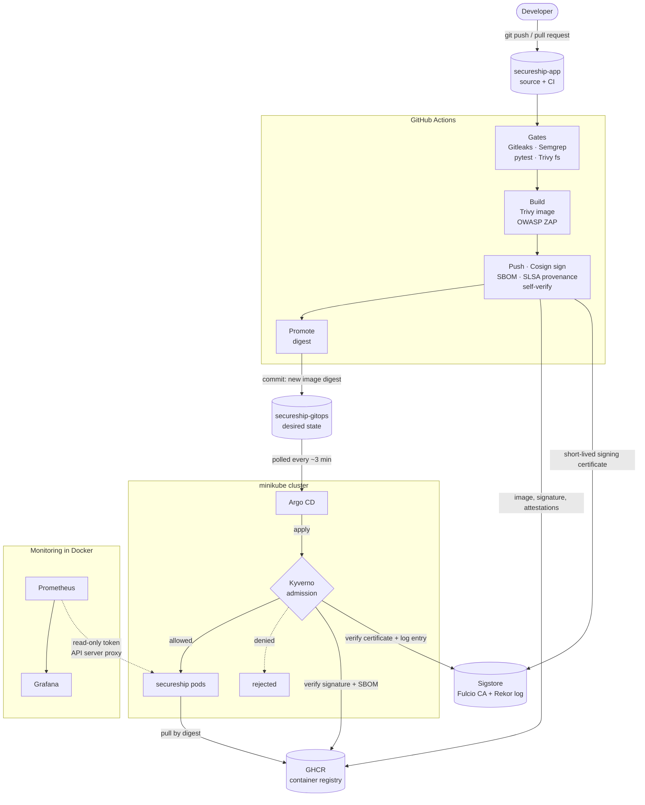
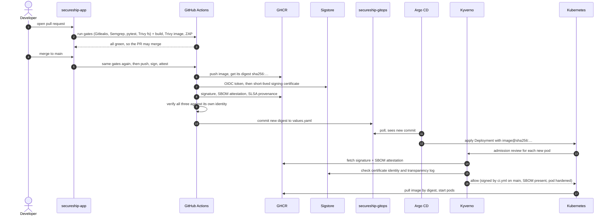
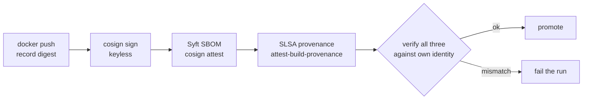
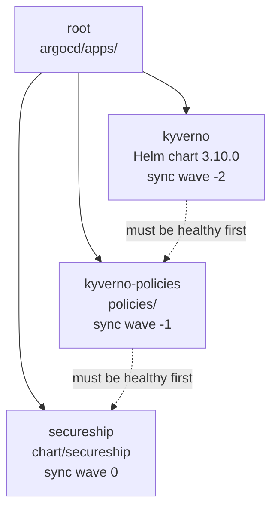
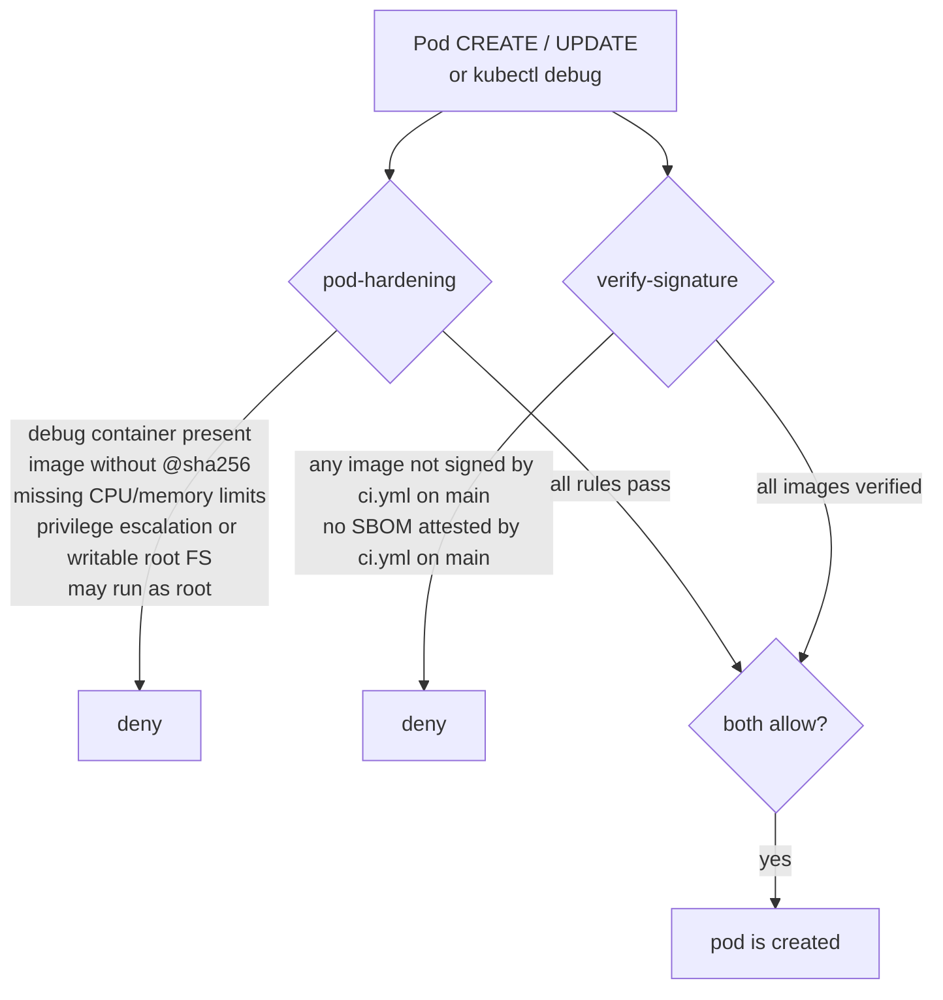
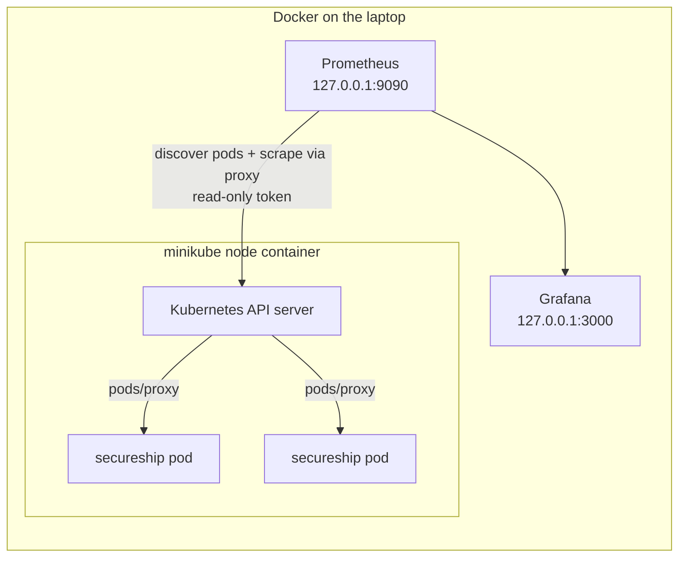

# SecureShip: architecture and build guide

This guide explains **what SecureShip does, how every part works, and how it was built, step by step**.
It is written to be read top to bottom. No prior knowledge of supply-chain security is assumed: terms are
explained the first time they appear, and there is a [glossary](#glossary) at the end.

- Short version and screenshots: [README](../README.md)
- Commands to run it yourself: [SETUP.md](https://github.com/ArpitSinghal-DevOps/secureship-gitops/blob/main/SETUP.md)

---

## Contents

1. [The idea in one paragraph](#1-the-idea-in-one-paragraph)
2. [The big picture](#2-the-big-picture)
3. [Two repositories, and why](#3-two-repositories-and-why)
4. [The journey of one commit](#4-the-journey-of-one-commit)
5. [How it was built, step by step](#5-how-it-was-built-step-by-step)
   - [Step 1: the application](#step-1-the-application)
   - [Step 2: the container image](#step-2-the-container-image)
   - [Step 3: quality and security gates before the build](#step-3-quality-and-security-gates-before-the-build)
   - [Step 4: build, image scan and DAST](#step-4-build-image-scan-and-dast)
   - [Step 5: sign, SBOM, provenance, self-check](#step-5-sign-sbom-provenance-self-check)
   - [Step 6: promotion to the GitOps repo](#step-6-promotion-to-the-gitops-repo)
   - [Step 7: the hardened Helm chart](#step-7-the-hardened-helm-chart)
   - [Step 8: GitOps with Argo CD](#step-8-gitops-with-argo-cd)
   - [Step 9: admission control with Kyverno](#step-9-admission-control-with-kyverno)
   - [Step 10: network isolation](#step-10-network-isolation)
   - [Step 11: monitoring](#step-11-monitoring)
   - [Step 12: a laptop with only Docker](#step-12-a-laptop-with-only-docker)
   - [Step 13: testing the platform itself](#step-13-testing-the-platform-itself)
6. [The chain of trust](#6-the-chain-of-trust)
7. [Security review: what was found and fixed](#7-security-review-what-was-found-and-fixed)
8. [Design decisions and trade-offs](#8-design-decisions-and-trade-offs)
9. [Limits and what comes next](#9-limits-and-what-comes-next)
10. [Glossary](#glossary)

---

## 1. The idea in one paragraph

Most attacks on software delivery do not break the application. They slip something into the path
between a developer's commit and the running server: a leaked password, a poisoned dependency, an image
built on someone's laptop, a hand-edited deployment. SecureShip closes that path. **Every commit is
scanned, every image is signed by the pipeline, and the cluster refuses to run anything the pipeline did
not sign.** The application is deliberately tiny (a three-endpoint FastAPI service), so that all the
attention goes to the delivery platform around it.

## 2. The big picture



There are four zones:

| Zone | What lives there | Who can change it |
|---|---|---|
| **Source** | `secureship-app`: code, Dockerfile, CI workflow | Developers, through a pull request with all checks green |
| **Pipeline** | GitHub Actions runners, GHCR, Sigstore | Only the workflow itself (short-lived tokens, no stored passwords) |
| **Desired state** | `secureship-gitops`: Helm chart, Argo CD apps, Kyverno policies | Developers by PR; the pipeline may only bump the image digest |
| **Runtime** | minikube cluster: Argo CD, Kyverno, the app | Nobody by hand: Argo CD reverts manual changes, Kyverno rejects unsigned images |

## 3. Two repositories, and why

| | `secureship-app` | `secureship-gitops` |
|---|---|---|
| Contains | FastAPI code, tests, Dockerfile, `ci.yml` | Helm chart, Argo CD Applications, Kyverno policies, policy tests, bootstrap script, containerised tools, monitoring config |
| Changes when | The application changes | The deployment changes, or a new image is promoted |
| CI | `secure-ci`: scan, build, sign, promote | `gitops-lint`: Helm lint, Trivy config scan, Kyverno policy tests |

Splitting them is the standard GitOps pattern, for three reasons:

1. **A clean audit trail.** Every deployment is a commit in `secureship-gitops`
   (`deploy: secureship-app 28730dc (sha256:fc2e90…)`), separate from code history. Rolling back is a `git revert`.
2. **Least privilege.** The pipeline holds an SSH deploy key that can write to `secureship-gitops` and
   nothing else. It never gets credentials for the cluster: Argo CD *pulls* from Git, CI never *pushes* to the cluster.
3. **No loops.** If CI wrote the digest back into the app repo, every deploy commit would trigger another build.

## 4. The journey of one commit



Timing on a normal day: about 3 minutes in CI, then up to 3 minutes for Argo CD to notice the new commit.

---

## 5. How it was built, step by step

Each step below says **what** was built, **why**, **how** (with the real configuration), and **how to
check it works**.

### Step 1: the application

**What.** A FastAPI service, [`app/main.py`](../app/main.py), with three endpoints:

| Endpoint | Returns |
|---|---|
| `/` | service name, version (the git commit), `"supply_chain": "scanned, signed, verified"` |
| `/health` | `{"status": "ok"}`, used by Kubernetes probes and by CI before DAST |
| `/metrics` | Prometheus metrics: request count and latency by method, path and status |

**Security choices inside the app:**

- **Interactive API docs are switched off** (`docs_url=None, redoc_url=None, openapi_url=None`). They load
  third-party JavaScript and describe the whole API to anyone who asks.
- **Security headers on every response**, added in one middleware: `Content-Security-Policy: default-src 'none'`,
  `X-Frame-Options: DENY`, `X-Content-Type-Options: nosniff`, `Referrer-Policy: no-referrer`, a restrictive
  `Permissions-Policy`, `Cache-Control: no-store` and `Cross-Origin-Resource-Policy: same-origin`.
  These are what the ZAP scan in step 4 checks for.
- **Metric cardinality is bounded.** Unknown paths are recorded as `other`. Without this, a scanner probing
  thousands of random URLs would create thousands of time series and could exhaust Prometheus' memory.
- **No server banner.** Uvicorn runs with `--no-server-header`.

**Check it.** [`tests/test_main.py`](../tests/test_main.py) asserts the responses, the security headers, that
`/docs` and `/openapi.json` return 404, and that metrics are recorded.

### Step 2: the container image

**What.** A two-stage [`Dockerfile`](../Dockerfile).

```dockerfile
FROM python:3.15-slim@sha256:65a65fc7… AS build      # stage 1: install dependencies
RUN pip install --no-cache-dir --prefix=/install -r requirements.txt

FROM python:3.15-slim@sha256:65a65fc7…               # stage 2: what actually ships
RUN apt-get update && apt-get upgrade -y && rm -rf /var/lib/apt/lists/*; \
    pip uninstall -y pip setuptools wheel; \
    useradd --uid 10001 --no-create-home --shell /usr/sbin/nologin app
COPY --from=build /install /usr/local
COPY app/ app/
USER 10001
```

**Why each line matters:**

| Choice | Reason |
|---|---|
| Base image pinned **by digest**, not just by tag | A tag such as `3.15-slim` can be moved to different content. A digest cannot. Dependabot proposes digest updates weekly. |
| Two stages | Build tools and caches stay in stage 1 and never reach the shipped image. |
| `apt-get upgrade` | Applies OS security fixes released after the base image was published. |
| `pip`, `setuptools`, `wheel` removed | Not needed at runtime, and a frequent source of CVE findings. |
| Fixed non-root user `10001` | The Kubernetes policy in step 9 requires non-root; a fixed UID makes that checkable. |
| `.dockerignore` | Keeps `.git`, tests and local files out of the image. |

### Step 3: quality and security gates before the build

The workflow [`ci.yml`](../.github/workflows/ci.yml) starts with four jobs that run **in parallel**. The
build job waits for all four (`needs: [secrets, sast, test, sca]`), so one failure stops everything.

| Job | Tool | Fails when | Detail |
|---|---|---|---|
| Secret scan | Gitleaks | a credential pattern appears **anywhere in the git history** of the commit | `fetch-depth: 0` gets the full history. Deleting a secret in a later commit does not hide it. |
| SAST | Semgrep (`p/python`, `p/owasp-top-ten`) | insecure code or workflow patterns | Also checks the GitHub workflow for injection risks. |
| Unit tests | pytest on Python 3.15 | a test fails | The same Python version as the image. |
| SCA | Trivy `fs` | a dependency or config has a HIGH or CRITICAL issue | Reads `requirements.txt` and the Dockerfile. |

**How the workflow itself is hardened:**

- **Every third-party action is pinned to a full commit SHA**, for example
  `actions/checkout@3d3c42e5… # v7.0.1`. A tag can be re-pointed by whoever controls the action's repo; a SHA cannot.
- Scanners run as **pinned container images** (`aquasec/trivy:0.76.2`, `zricethezav/gitleaks:v8.30.1`, …),
  not as install scripts piped into a shell.
- **Least-privilege tokens:** the workflow default is `contents: read`. Only the build job gets
  `packages: write`, `id-token: write` and `attestations: write`, and only for what it does.
- **Branch protection on `main`:** merging needs a pull request with all checks green; force-push and deletion are blocked.
- **Dependabot** watches pip packages, the Docker base image and the GitHub Actions themselves, with a
  7-day cooldown so brand-new (possibly compromised) releases are not adopted on day one.

**Check it.** Two pull requests are kept open on purpose:
[#3](https://github.com/ArpitSinghal-DevOps/secureship-app/pull/3) adds a fake GitHub token (only Gitleaks fails), and
[#2](https://github.com/ArpitSinghal-DevOps/secureship-app/pull/2) adds `python-multipart==0.0.6`, which has HIGH CVEs (only Trivy fs fails).

### Step 4: build, image scan and DAST

Once the gates pass, the build job:

1. **Builds** the image, tagged with the commit SHA and labelled with `org.opencontainers.image.source`
   (which links the GHCR package to the repo, so it inherits public visibility) and `.revision`.
2. **Scans the built image** with Trivy for HIGH or CRITICAL CVEs in OS packages and libraries
   (`--ignore-unfixed`: only problems that have a fix can fail the build, otherwise the pipeline would be
   blocked by something nobody can act on).
3. **Runs the container and attacks it** with the OWASP ZAP baseline scan (DAST: testing the running
   app from the outside, like an attacker would). FAIL-level alerts stop the build; the full HTML/JSON
   report is uploaded as a build artifact.

On pull requests the job stops here: nothing is pushed or signed for unmerged code.

### Step 5: sign, SBOM, provenance, self-check

This is the heart of the project. On `main` only, the build job continues:



**5a. Push and record the digest.** After `docker push`, the job reads the image's **digest**
(`sha256:…`, a fingerprint of the exact bytes). From here on, the image is only ever referred to by digest.

**5b. Keyless signing with Cosign.** Traditional signing needs a private key that someone must store and
protect. Keyless signing (Sigstore) avoids that:

1. GitHub gives the running job an **OIDC token**: a signed statement saying *"I am workflow
   `ArpitSinghal-DevOps/secureship-app/.github/workflows/ci.yml`, running on `refs/heads/main`"*.
2. Sigstore's certificate authority (**Fulcio**) exchanges that token for a **certificate valid for 10
   minutes**, with that identity written inside it.
3. Cosign signs the digest, and the signature is recorded in Sigstore's public, append-only
   **transparency log (Rekor)**, so it can be audited later and cannot be quietly back-dated.
4. The signature is stored in GHCR next to the image.

There is no key to leak. A signature proves *which workflow, on which branch*, produced the image.

**5c. SBOM.** Syft lists every package inside the image (an SBOM, "software bill of materials", in SPDX
format). `cosign attest --type spdxjson` signs that list and attaches it to the image. If a new CVE is
announced tomorrow, you can answer "are we affected?" without rebuilding anything.

**5d. SLSA build provenance.** `actions/attest-build-provenance` records *how* the image was built: the
repository, commit, workflow and runner. It is signed the same keyless way and pushed to GHCR. SLSA is
the industry framework for this kind of build integrity.

**5e. Self-verification.** Before promoting, CI checks its own work with the same identity rules the
cluster will use:

```bash
ID="https://github.com/$GITHUB_REPOSITORY/.github/workflows/ci.yml@$GITHUB_REF"
cosign verify             --certificate-identity "$ID" --certificate-oidc-issuer "$ISSUER" "$REF"
cosign verify-attestation --type spdxjson --certificate-identity "$ID" ... "$REF"
gh attestation verify "oci://$REF" --repo "$GITHUB_REPOSITORY" --signer-workflow ".../ci.yml"
```

A broken signature therefore fails in CI, with a clear log, rather than as a confusing pod rejection later.

### Step 6: promotion to the GitOps repo

The last job, `update-gitops`, checks out `secureship-gitops` with an **SSH deploy key** (write access
to that one repo only), sets the new digest with `yq`, and commits:

```
deploy: secureship-app 28730dc (sha256:fc2e902329e0…)
```

Two details make this safe when several pushes happen close together:

- **Runs are queued, not raced.** A `concurrency` group per branch means runs on `main` happen one at a
  time, and a newer push replaces any run still waiting. An older, slower build can never finish last
  and overwrite a newer digest. (On pull requests, a new push cancels the outdated run instead.)
- **Push with retry.** If someone else changed `secureship-gitops` in the meantime, the job rebases and
  retries up to three times.

Commits that only touch Markdown or `docs/` are ignored by the workflow, so documentation changes do not redeploy.

### Step 7: the hardened Helm chart

The chart in `secureship-gitops/chart/secureship/` produces the Kubernetes objects for the app.

**Image by digest only.** The template refuses to render without one:

```yaml
{{- if not .Values.image.digest }}
{{- fail "image.digest is empty: run the secureship-app pipeline once ..." }}
{{- end }}
image: "{{ .Values.image.repository }}@{{ .Values.image.digest }}"
```

**Pod and container hardening:**

| Setting | Effect |
|---|---|
| `runAsNonRoot: true`, `runAsUser: 10001` | The process cannot run as root. |
| `allowPrivilegeEscalation: false` | It cannot gain more privileges later (for example via setuid binaries). |
| `capabilities: drop: ["ALL"]` | No special kernel permissions at all. |
| `readOnlyRootFilesystem: true` | An attacker cannot write tools or change code inside the container. A small `emptyDir` (16 MiB) is mounted at `/tmp` for the one place that needs writes. |
| `seccompProfile: RuntimeDefault` | Blocks dangerous system calls. |
| `automountServiceAccountToken: false` | The app gets no Kubernetes API credentials; it does not need any. |
| CPU and memory requests and limits | One pod cannot starve the node. |
| Readiness and liveness probes on `/health` | Traffic only goes to healthy pods; stuck pods are restarted. |

The chart also creates the NetworkPolicy (step 10) and the read-only metrics identity (step 11).

### Step 8: GitOps with Argo CD

**GitOps** means the cluster's desired state is a Git repository, and an agent inside the cluster keeps
reality equal to it. Here that agent is Argo CD.

**App of apps.** Only one object is ever applied by hand: [`argocd/root.yaml`](https://github.com/ArpitSinghal-DevOps/secureship-gitops/blob/main/argocd/root.yaml).
It points Argo CD at the `argocd/apps/` folder, which defines three more Applications:



**Order matters.** If the app were deployed before Kyverno and its policies, unsigned pods could start
before the guard is in place. **Sync waves** set the order: Kyverno (wave -2), then policies (-1), then
the app (0). By default Argo CD does not wait for a child Application to be *healthy* before starting
the next wave, so `scripts/bootstrap.sh` adds a small Lua health check for `Application` resources that
makes it wait.

**Self-healing.** Every Application has `automated: {prune: true, selfHeal: true}`:

- **selfHeal:** someone runs `kubectl scale --replicas=5`; within seconds Argo CD sets it back to 2.
- **prune:** something removed from Git is removed from the cluster.

**Bootstrap.** [`scripts/bootstrap.sh`](https://github.com/ArpitSinghal-DevOps/secureship-gitops/blob/main/scripts/bootstrap.sh)
creates (or restarts) the minikube cluster with the **Calico** network plugin (needed for NetworkPolicy
to actually be enforced), waits for the API, installs a pinned Argo CD version, adds the health check
and applies the root app. From there, everything else comes from Git.

### Step 9: admission control with Kyverno

Kubernetes asks an **admission controller** "may I create this?" before storing any object. Kyverno is
one, and its answer is final: a denied pod never exists. Both policies use the modern CEL-based policy
types, are scoped to the `secureship` namespace, and are in `Deny` mode.

Both policies are evaluated on every request, independently. The pod is created only if **both** allow it.



**Policy 1: [`pod-hardening.yaml`](https://github.com/ArpitSinghal-DevOps/secureship-gitops/blob/main/policies/pod-hardening.yaml)** (a `ValidatingPolicy`).
It applies the rules from step 7 to **app and init containers** (an init container runs before the app
starts, with the same access), and refuses **ephemeral containers** outright. Those are what
`kubectl debug` attaches to a running pod, which is why the policy also matches the
`pods/ephemeralcontainers` subresource. A short extract:

```yaml
variables:
  - name: workloadContainers
    expression: object.spec.containers + object.spec.?initContainers.orValue([])
validations:
  - expression: "!has(object.spec.ephemeralContainers) || size(object.spec.ephemeralContainers) == 0"
    message: "ephemeral (debug) containers are not allowed in this namespace"
  - expression: "variables.workloadContainers.all(c, c.image.contains('@sha256:'))"
    message: "images must be pinned by digest (no mutable tags such as :latest), including init containers"
```

**Policy 2: [`verify-image-signature.yaml`](https://github.com/ArpitSinghal-DevOps/secureship-gitops/blob/main/policies/verify-image-signature.yaml)** (an `ImageValidatingPolicy`).
For **every image in every container list**, Kyverno checks that:

1. it has a Cosign signature whose certificate was issued by GitHub's OIDC issuer to exactly
   `https://github.com/ArpitSinghal-DevOps/secureship-app/.github/workflows/ci.yml@refs/heads/main`,
   and is recorded in Rekor; and
2. it has an SPDX SBOM attestation (`https://spdx.dev/Document`) signed by that same identity.

An image built on a laptop, in a fork, or from a feature branch fails rule 1. An image someone signed
but did not run through the full pipeline fails rule 2. The webhook timeout is raised to 30 seconds
(the Kubernetes maximum), because the first check on a cold cache has to contact GHCR, Rekor and the
Sigstore trust root.

**A small RBAC addition.** Kyverno's reports controller needs read access to
`pods/ephemeralcontainers` before it marks the policies as ready. That is granted with an aggregated
ClusterRole, [`policies/kyverno-rbac.yaml`](https://github.com/ArpitSinghal-DevOps/secureship-gitops/blob/main/policies/kyverno-rbac.yaml).

**Check it** (real output from the cluster):

```console
$ kubectl run evil -n secureship --image=nginx@sha256:6784fb08…   # hardened in every way, but unsigned
Error from server: ... Policy verify-secureship-signature failed: image is not signed by the
secureship-app CI pipeline (main branch); ... no signatures found

$ kubectl debug -n secureship pod/secureship-… --image=busybox
Error from server: ... Policy secureship-pod-hardening failed: ephemeral (debug) containers are not allowed in this namespace
```

### Step 10: network isolation

[`networkpolicy.yaml`](https://github.com/ArpitSinghal-DevOps/secureship-gitops/blob/main/chart/secureship/templates/networkpolicy.yaml)
makes the app pods **default-deny** in both directions, then opens exactly two holes:

- **In:** TCP 8080 (the app port).
- **Out:** DNS (port 53, UDP and TCP) to `kube-system` only.

So even if the app were compromised, it could not download tools, call out to an attacker's server,
or reach other services. minikube is started with Calico because the default network plugin ignores
NetworkPolicy objects.

### Step 11: monitoring

The app exposes `/metrics`; Prometheus collects it and Grafana shows a dashboard with **request rate by
path, error rate (4xx + 5xx), p95 latency and pod restarts**.

The usual approach (kube-prometheus-stack inside the cluster) needs 1.5 GB+ of RAM, too much for a
laptop already running Kubernetes. So Prometheus and Grafana run as **two small Docker containers next
to the minikube container** (about 250 MB together), started with `tools/monitoring up`.



How a container *outside* the cluster scrapes pods *inside* it, without opening anything:

1. The chart creates a **ServiceAccount `secureship-metrics-reader`** whose Role allows only `get/list/watch pods`
   and `get pods/proxy`, in the `secureship` namespace, and nothing else.
2. `tools/monitoring up` copies that account's token and the cluster CA into `monitoring/.secrets/`
   (git-ignored, mode 600).
3. Prometheus discovers pods through the API and scrapes
   `https://<api-server>/api/v1/namespaces/secureship/pods/<pod>:8080/proxy/metrics`.

Both containers run as the user's UID with **all capabilities dropped, no-new-privileges, memory limits,
and ports bound to `127.0.0.1` only**. The Grafana admin password is randomly generated on first start.
The in-cluster alternative is kept in `argocd/optional/monitoring.yaml` for machines with more RAM.

### Step 12: a laptop with only Docker

Installing kubectl, minikube, gh, cosign and yq on a personal machine is friction, and a security risk
of its own. So **every CLI runs in a container** through small wrappers in `secureship-gitops/tools/`:

| Wrapper | What it runs | How |
|---|---|---|
| `tools/k` | kubectl | The kubectl binary that already ships *inside* the minikube node, via `docker exec` |
| `tools/run` | gh, git, cosign, yq | A toolbox image built from [`tools/Dockerfile`](https://github.com/ArpitSinghal-DevOps/secureship-gitops/blob/main/tools/Dockerfile) |
| `tools/minikube` | minikube | The toolbox image, driving the host's Docker through its socket |
| `tools/monitoring` | Prometheus + Grafana | Two hardened containers (step 11) |

The toolbox image downloads cosign and minikube and **checks their SHA-256 checksums** before
installing them. The GitHub login is kept in a named Docker volume, not on the host.

### Step 13: testing the platform itself

Security controls that are never tested tend to stop working silently. SecureShip tests its own guards:

| Test | Where | What it proves |
|---|---|---|
| **Kyverno policy unit tests** (`tests/`) | gitops CI | 7 pods: 2 hardened ones pass, 5 bad ones fail (`:latest`, no limits, root, unpinned init container, debug container) |
| **Signature tests against real images** (`tests/signature/`) | gitops CI | A real signed image passes; an unsigned one fails; **signed app + unsigned init container fails** |
| **Rendered chart vs policy** | gitops CI | The Deployment the chart actually produces passes the hardening policy. The step fails if nothing was evaluated. |
| **Trivy config scan of the chart** | gitops CI | No HIGH/CRITICAL Kubernetes misconfigurations |
| **Demo pull requests** #2 and #3 | app CI | Each fails exactly the gate it targets |
| **Live attacks** | the cluster | Unsigned image, init-container bypass, `kubectl debug`, mutable tag: all denied. Manual scaling: reverted. |

---

## 6. The chain of trust

Each link checks the one before it. Nothing relies on "we pushed it, so it must be fine".

| # | Claim | Who checks it | How |
|---|---|---|---|
| 1 | The code is clean | CI gates | Gitleaks, Semgrep, pytest, Trivy fs |
| 2 | The image is what CI built from that code | Cosign signature | Certificate identity = `ci.yml@refs/heads/main`, logged in Rekor |
| 3 | We know what is inside the image | SBOM attestation | SPDX SBOM signed by the same identity |
| 4 | We know how it was built | SLSA provenance | GitHub artifact attestation, `gh attestation verify` |
| 5 | Deployed = signed | Digest pinning | Same `sha256` from push to Git to pod |
| 6 | The cluster runs only signed, hardened pods | Kyverno | Checked at every pod creation, for every container |
| 7 | The cluster matches Git | Argo CD | Continuous sync with self-heal and prune |

Anyone can verify links 2 and 4 from outside:

```bash
IMG=ghcr.io/arpitsinghal-devops/secureship-app@<digest from secureship-gitops values.yaml>
cosign verify "$IMG" --certificate-oidc-issuer https://token.actions.githubusercontent.com \
  --certificate-identity-regexp '^https://github.com/ArpitSinghal-DevOps/secureship-app/'
gh attestation verify "oci://$IMG" --repo ArpitSinghal-DevOps/secureship-app
```

## 7. Security review: what was found and fixed

After the first version worked end to end, the whole platform was reviewed and every fix was tested,
first locally, then on a fresh cluster. These findings are the most instructive part of the project.

| # | Finding | Impact | Fix |
|---|---|---|---|
| 1 | **Init-container bypass.** Both policies only looked at `spec.containers`. | An unsigned, unpinned image could run as an init container (or be attached with `kubectl debug`) next to a signed app container. Confirmed by running the old policy against test pods: both were admitted. | Policies cover app, init and ephemeral containers; debug containers are denied; regression tests added. ([gitops#1](https://github.com/ArpitSinghal-DevOps/secureship-gitops/pull/1)) |
| 2 | **A CI check that checked nothing.** "Rendered chart passes pod-hardening" applied a Pod policy to a Deployment. | It always reported `pass: 0, fail: 0`, a green tick with zero coverage. | The pod template is extracted and tested, and the step fails unless exactly one result passes. ([gitops#1](https://github.com/ArpitSinghal-DevOps/secureship-gitops/pull/1)) |
| 3 | **SBOM attested but never required.** | An image signed by the pipeline but with no SBOM would have been admitted. | The signature policy also requires the SBOM attestation; negative-tested by asking for a predicate type the image lacks. ([gitops#1](https://github.com/ArpitSinghal-DevOps/secureship-gitops/pull/1)) |
| 4 | **Promotion race.** | Two pushes close together could let the older build promote last, silently rolling back. | Ordered runs per branch, plus rebase-and-retry on push. ([app#5](https://github.com/ArpitSinghal-DevOps/secureship-app/pull/5)) |
| 5 | **Base image by tag.** | The starting point of every build could change without a commit. | Pinned by digest; Dependabot updates it. ([app#5](https://github.com/ArpitSinghal-DevOps/secureship-app/pull/5)) |
| 6 | **Restarting the cluster broke it.** `bootstrap.sh` used a bare `docker start`, which skipped minikube's restart steps, and a timeout in the wait loop was silently ignored. | After a laptop reboot the API never came back, and the error appeared three steps later as an unrelated DNS failure. | Restart through `minikube start`; fail clearly if the API is not ready. Tested by a stop-and-restart. ([gitops#2](https://github.com/ArpitSinghal-DevOps/secureship-gitops/pull/2)) |
| 7 | **Policies "not ready" on a fresh cluster.** Matching `pods/ephemeralcontainers` needed an extra Kyverno permission. | Argo CD saw the policies as Degraded, so the app wave never started. | Aggregated ClusterRole; verified on a fresh cluster. ([gitops#3](https://github.com/ArpitSinghal-DevOps/secureship-gitops/pull/3)) |
| 8 | **A demo that proved the wrong thing.** The vulnerable-dependency PR also failed its unit tests (`requests 2.19` cannot install next to FastAPI). | It was not clear that the CVE scan alone blocked it. | Switched to `python-multipart==0.0.6`: only Trivy fs fails now. |

The common lesson: **a control is only as good as its test.** Findings 1, 2 and 3 all passed CI before the review.

## 8. Design decisions and trade-offs

| Decision | Chosen | Alternative | Why |
|---|---|---|---|
| Signing | Keyless (Sigstore, OIDC) | A long-lived Cosign key pair | No secret to store, rotate or leak; identity is tied to the exact workflow and branch. Trade-off: depends on Sigstore's public services being reachable. |
| Deploy reference | Image digest | Tag (`:v1.2`, `:latest`) | A tag can be re-pointed after scanning; a digest is the scanned bytes. |
| Delivery | Pull (Argo CD) | Push (CI runs `kubectl apply`) | CI never holds cluster credentials; drift is corrected continuously. |
| Admission engine | Kyverno CEL policies | OPA Gatekeeper, Sigstore policy-controller | Signature checks and pod rules in one tool, written in YAML/CEL, with a CLI that can test policies in CI. |
| Cluster | minikube + Calico | kind, k3d, a cloud cluster | Free, runs on a laptop, and Calico actually enforces NetworkPolicy. |
| Monitoring | Prometheus + Grafana in Docker, beside the cluster | kube-prometheus-stack in the cluster | About 250 MB instead of 1.5 GB+; the in-cluster version stays available as an option. |
| Tooling | Containerised CLIs | Installing them on the host | One prerequisite (Docker), reproducible versions, checksum-verified downloads. |
| Repos | Public | Private | Free Actions minutes and GHCR storage, and a public portfolio. Sigstore records are public by design anyway. |

## 9. Limits and what comes next

This is a laptop-scale reference platform, not a production system. Knowingly out of scope:

- **Runtime threat detection** (for example Falco): the platform controls what *starts*, not what a running process *does*.
- **Secrets management** (Vault, External Secrets): the app has no secrets.
- **Multiple environments**: one cluster, no staging-to-production promotion.
- **Alerting**: dashboards exist, alert rules do not.
- **Argo CD hardening**: Applications use the `default` project; a restricted `AppProject` would limit which repos and namespaces each app may use.
- **Node or cluster-admin compromise**: anyone with cluster-admin can remove the policies.

Natural next steps, in order of value: a restricted Argo CD `AppProject`, Prometheus alert rules, a
PodDisruptionBudget, then a second environment with promotion between them.

---

## Glossary

| Term | Meaning |
|---|---|
| **Admission controller** | A Kubernetes component asked to approve every object before it is stored. Kyverno is one. |
| **Attestation** | A signed statement *about* an artifact, such as "this is its SBOM" or "this is how it was built". |
| **CEL** | Common Expression Language: the small, safe expression language Kubernetes and Kyverno use for rules. |
| **Cosign** | The Sigstore tool that signs and verifies container images and attestations. |
| **DAST** | Dynamic application security testing: attacking the running app from outside (here, OWASP ZAP). |
| **Digest** | `sha256:…`, a content fingerprint of an image. Change one byte and the digest changes. |
| **Ephemeral container** | A temporary container added to a running pod, usually by `kubectl debug`. |
| **GitOps** | Running a system from a Git repository: Git holds the desired state, an agent makes reality match it. |
| **Init container** | A container that runs to completion before the app containers start, in the same pod. |
| **Keyless signing** | Signing with a short-lived certificate issued for an identity (here, a GitHub workflow) instead of a stored private key. |
| **OIDC token** | A signed identity token. GitHub issues one to each workflow run, stating which repo, workflow and branch it is. |
| **Rekor** | Sigstore's public, append-only transparency log of signatures. |
| **SAST** | Static application security testing: scanning source code for insecure patterns (here, Semgrep). |
| **SBOM** | Software bill of materials: the list of every package inside an artifact (here, SPDX format from Syft). |
| **SCA** | Software composition analysis: finding known vulnerabilities in dependencies (here, Trivy). |
| **SLSA** | Supply-chain Levels for Software Artifacts: a framework for build integrity; *provenance* is its record of how something was built. |
| **Sync wave** | An Argo CD setting that orders which resources or apps are applied first. |
